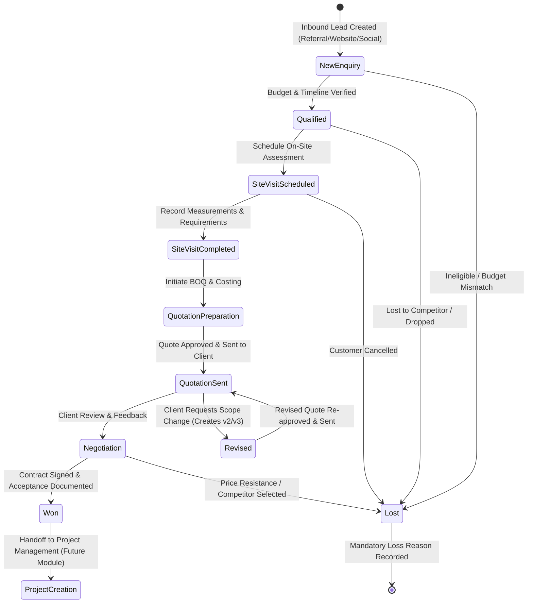
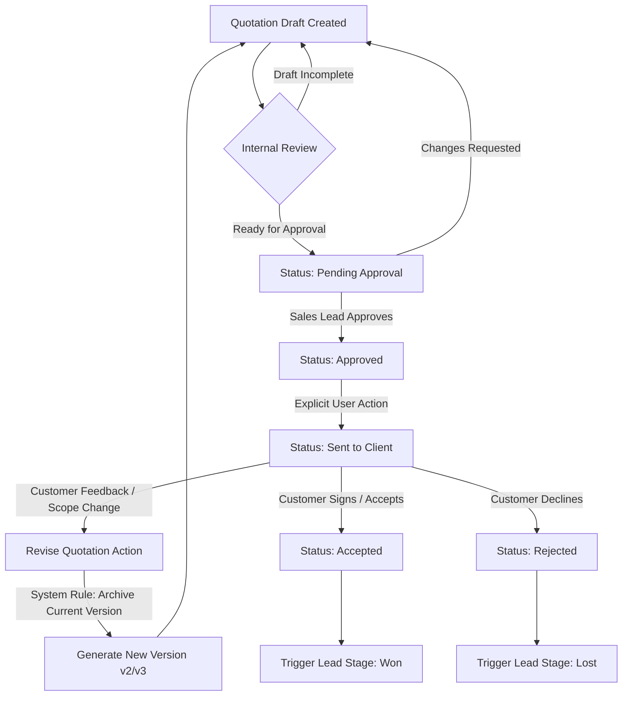

# ULI Studio ERP — Leads & CRM Module Prototype

> **Version:** 0.2.0 · Prototype  
> **Module:** Leads & Customer Relationship Management (CRM)  
> **Status:** All 11 screens fully implemented and interactive.  
> **Data:** All values are **DEMO DATA** for prototype review.

---

## 1. Quick Start

1. Open `uli-crm/index.html` directly in any modern web browser (Google Chrome, Mozilla Firefox, Microsoft Edge, Safari).
2. Or serve via local web server:
   ```bash
   cd "c:\Users\tejes\OneDrive\Desktop\ULI ERP\uli-crm"
   python -m http.server 8080
   ```
   Navigate to `http://localhost:8080`.
3. To jump back to the **Overview Dashboard**, click the **"Overview"** link in the sidebar or profile menu.
4. From the Overview Dashboard (`uli-dashboard/index.html`), click **"Leads & CRM"** in the sidebar to navigate back to this module.

---

## 2. Screen Inventory (11 Screens)

| # | Screen Name | Description | Key Features |
|---|-------------|-------------|--------------|
| **1** | **CRM Dashboard** | Executive sales overview | 4 KPI cards (New Leads, Pipeline Value, Quote-to-Won %, Overdue Follow-ups), Overdue table, Upcoming schedule, Visual pipeline summary bar, Acquisition source breakdown, Recent activities feed, Filters. |
| **2** | **Leads List** | Master enquiries & opportunities data table | Columns: Lead ID, Customer & Project, Contact, Type/Source, Rep, Stage badge, Expected Value, Next Follow-up with overdue highlight, Created date, Action icons (View, Stage, Assign). Search, Filters, Sorting, Pagination (8/page). |
| **3** | **Create New Lead** | Dedicated lead intake form | Form sections: Customer Info, Project/Enquiry Details, Lead Ownership & Next Action. Real-time **Duplicate Customer detection banner**, mandatory field validation, unique `LD-2026-XXX` ID generation. |
| **4** | **Lead Detail Workspace** | Central command center for an active opportunity | Interactive clickable Stage Stepper milestone tracker, Quick action buttons (Edit, Assign Rep, Schedule Follow-up, New Quote), Won deal confirmation alert with Project handoff notice, **7 workspace tabs**: 1. Overview, 2. Activities (with composer for Call/Email/Meeting/Note/WhatsApp), 3. Follow-ups, 4. Site Visits, 5. Quotations, 6. Stage History, 7. Documents. |
| **5** | **Pipeline Board** | 9-Stage Kanban board | Columns for all 9 stages (`New Enquiry` to `Won`/`Lost`) with lead count and total pipeline value sum per column. HTML5 **Drag-and-Drop** stage progression, stage change confirmation dialogs, list-view toggle. |
| **6** | **Follow-up Management** | Action-oriented sales scheduler | Filter chips (All, Today's, Upcoming, Overdue, Completed), Follow-up cards with lead context, Complete with outcome notes, Reschedule, Reassign, Cancel workflows. |
| **7** | **Site Visit Management** | On-site architectural assessment log | Views for Scheduled, Completed visits. Scheduling form (Location, Date/Time, Purpose, Rep, Prep notes), and **Record Visit Report modal** (Outcome, Customer Requirements, Measurements & Observations, Next Action). |
| **8** | **Funnel Analysis** | Multi-stage sales conversion analytics | 6-stage visual sales funnel with proportional color bars, Stage conversion %, Drop-off %, Overall conversion % (with clearly documented denominators), Performance by Salesperson table, Performance by Source table. |
| **9** | **Quotations List** | Commercial proposals register | Columns: Quote Ref, Customer, Linked Lead, Version, Estimated Value, Creator, Created date, Valid until, Status badge, Actions (View, Revise). Search & Status filter. |
| **10** | **Quotation Builder** | Interactive Bill of Quantities (BOQ) editor | Metadata form linked to lead, Dynamic BOQ table with inline editing, row additions, deletions, Category, Qty, Rate, Discount %, Tax category. Real-time calculations: Subtotal, Discount, Taxable, GST, Grand Total. Save Draft, Preview, and Submit for Approval actions. |
| **11** | **Quotation Detail & Revisions** | Printable PDF-style proposal with version history | Formal corporate document view with BOQ breakdown, scope, terms, approval audit badge. **Version history pills (v1, v2, v3)**. "Revise Quote" preserves sent versions without overwriting. Separate Approval and Send actions. |

---

## 3. Lead Lifecycle & State Transition Diagram



---

## 4. Quotation Workflow Diagram



---

## 5. Business Rules Implemented

1. **Unique Lead Identification**: Every lead receives a unique immutable identifier (e.g., `LD-2026-001`).
2. **Duplicate Customer Detection**: Real-time duplicate checking on Customer Name and Phone number flags existing CRM records before submission.
3. **Mandatory Ownership**: Every lead must have an assigned Salesperson/Designer.
4. **Stage Transition Audit**: Every stage change records timestamp, user, previous stage, new stage, and transition notes into `CRM_STAGE_HISTORY`.
5. **Loss Reason Mandatory**: Moving a lead to `Lost` requires selecting a categorized loss reason (`CRM_LOSS_REASONS`) and descriptive notes.
6. **Won Stage Acceptance Documentation**: Moving to `Won` requires documenting customer acceptance and shows confirmation that a project will be created in the Project Management module.
7. **Overdue Follow-up Dynamic Classification**: Follow-ups are dynamically marked overdue if `date < now` and `status === 'Pending'`.
8. **Quotation Version Immutability**: If a quotation has been marked `Sent` or `Accepted`, clicking edit triggers a revision workflow that archives the historical version in `previousVersions` and generates a new version number (e.g. `v1` → `v2`), preventing overwrite of client-facing sent documents.
9. **Separation of Approval and Sending**: Quotation approval is a distinct internal workflow step from sending the quotation to the client.
10. **Real-time Prototype Calculation**: Bill of Quantities (BOQ) calculates Gross Subtotal, Line Discounts, Taxable Value, Tax (CGST+SGST/IGST), and Grand Total live as items are edited.

---

## 6. Test Checklist

### Functional
- [x] CRM Dashboard loads with 4 KPI cards and responsive charts.
- [x] Leads list displays 15 records with sortable columns and pagination.
- [x] Search filters leads by name, ID, phone, and project title.
- [x] Filters by Stage, Salesperson, Source, and Priority filter table rows accurately.
- [x] "Add New Lead" form validates required inputs and displays duplicate customer warning if matching name/phone is entered.
- [x] Submitting lead creates new `LD-2026-016` record, records initial activity and stage history.
- [x] Lead Detail workspace renders all 7 tabs (Overview, Activities, Follow-ups, Site Visits, Quotations, Stage History, Documents).
- [x] Activity composer logs Call, Email, Meeting, WhatsApp, and Note into the activity feed.
- [x] Pipeline Kanban board displays 9 stage columns with correct lead counts and total value sums.
- [x] HTML5 drag-and-drop between Kanban columns moves leads with prompt confirmations.
- [x] Moving a lead to Lost demands loss reason; moving to Won requires acceptance notes.
- [x] Follow-up management shows Today's, Upcoming, Overdue, and Completed follow-ups.
- [x] Follow-up actions (Complete with outcome, Reschedule, Reassign, Cancel) work smoothly.
- [x] Site visit scheduling and Post-visit measurement report recording function properly.
- [x] Funnel Analysis renders 6 stages with explicit conversion and drop-off percentages.
- [x] Quotation Builder BOQ table dynamically updates totals upon changing quantity, rate, discount, or tax.
- [x] Quotation Detail displays formal paper layout, version pills, and allows generating new revisions without overwriting historical versions.

### Integration with Overview Dashboard
- [x] Clicking "Leads & CRM" in `uli-dashboard/index.html` navigates to `uli-crm/index.html`.
- [x] Quick action "Create Lead" in the Overview Dashboard provides a direct link to the CRM workspace.
- [x] Clicking "Overview" in `uli-crm/index.html` returns to the Overview Dashboard.

---

## 7. Questions Requiring Business Clarification

1. **GST Handling**: Does the studio deal with Intra-state (CGST + SGST 9%+9%) vs Inter-state (IGST 18%) depending on the site location vs company registered state?
2. **Quotation Approval Hierarchy**: What threshold requires Sales Lead vs Partner/Director approval? (e.g., quotes > ₹50 Lakhs requiring MD approval).
3. **Discount Authority**: Is there a maximum discount percentage a designer can offer before manager approval is required?
4. **Project Creation Rules**: Upon marking a deal Won, what default milestones should automatically populate the project schedule (Concept Design, Schematic, BOQ, Execution, Handover)?
5. **Customer Duplicate Policy**: When a duplicate customer is detected, should the system allow merging enquiries or creating secondary project scopes under the same customer master?
