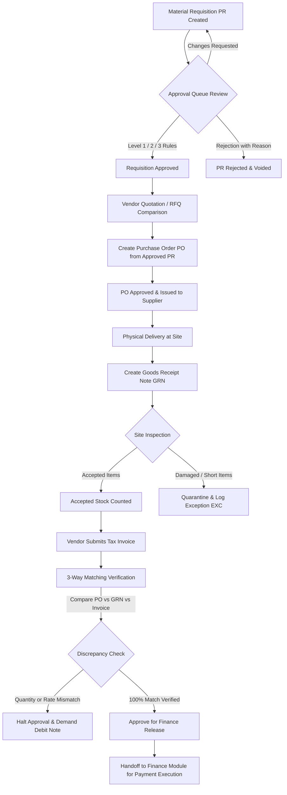
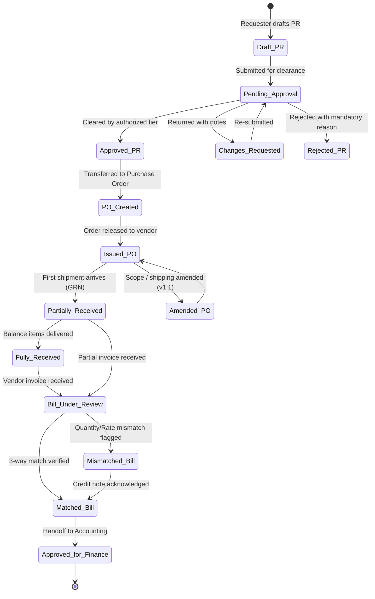

# ULI Studio ERP — Purchase & Procurement (PO) Prototype

> **Version:** 0.3.0 · Prototype  
> **Module:** Purchase, Procurement & Vendor Management (Purchase & PO)  
> **Status:** All 15 screens fully implemented and interactive.  
> **Data:** All values are **DEMO DATA** for prototype workflow validation.

---

## 1. Quick Start

1. Open `uli-purchase/index.html` directly in any modern web browser (Google Chrome, Mozilla Firefox, Microsoft Edge, Safari).
2. Or serve via local web server:
   ```bash
   cd "c:\Users\tejes\OneDrive\Desktop\ULI ERP\uli-purchase"
   python -m http.server 8080
   ```
   Navigate to `http://localhost:8080`.
3. To jump between modules:
   - Click **"Overview"** in the sidebar to visit the Executive Overview Dashboard (`uli-dashboard/`).
   - Click **"Leads & CRM"** in the sidebar to visit the Sales & CRM Workspace (`uli-crm/`).
   - Click **"Purchase & PO"** in any module to return here.

---

## 2. Screen Inventory (15 Screens)

| # | Screen Name | Description | Key Features |
|---|-------------|-------------|--------------|
| **1** | **Purchase Dashboard** | Procurement executive cockpit | 4 KPI cards (PRs Awaiting, Open POs, GRNs Pending, Payables Due in Next 7 Days). Pending PRs table, Open POs table, Overdue Supplier Accounts (3-Way Mismatch) table, Procurement lifecycle pipeline breakdown, and Recent activities log. Filterable by Project, Vendor, and Date Range. |
| **2** | **Purchase Requisition List** | Requisitions master register | Table columns: PR Number, Project & Site, Requested By, Department, Required Date, Items count, Estimated Amount, Status badge, Approver, Actions (View, Edit, PO). Search, Project & Status filter. |
| **3** | **Create Purchase Requisition** | Requisition intake form | General Info: Project, Site (auto-filled), Requester, Department, Required By, Priority, Purpose/Justification. Material line items table with dynamic add/remove rows (Name, Category, Spec, Unit, Qty, Rate, Line Total). Auto-calculated estimated grand total with dynamic approval tier threshold badge. Sourcing preferences & attachment dropzone. |
| **4** | **PR Detail & Approval** | Requisition workspace | Metadata chips, Requested Bill of Materials table, Approval History & Audit Trail. Actions: Submit for Approval, Approve (with Segregation of Duties check), Reject (mandatory reason modal), Request Changes (mandatory modifications modal), and Create PO from Approved PR. |
| **5** | **Approval Queue** | Centralized approval inbox | Displays PRs requiring action with Requester, Project, Amount, Submission Date, Approval Level, Current Approver, and Pending Duration. Active configurable governance rules banner (Level 1: PM ≤ ₹1L; Level 2: Head ≤ ₹10L; Level 3: MD > ₹10L). |
| **6** | **Vendor Comparison / RFQ** | Material quote evaluation matrix | Side-by-side vendor quotes comparison: Unit Rate, Tax, Total Cost, Delivery Lead Time, Payment Terms, Warranty, Availability, Remarks. Algorithmic **Recommended Quote** ribbon based on price + delivery balance without automated forced selection. Configurable RFQ policy note. |
| **7** | **Purchase Order List** | Master contractual orders register | Columns: PO Number, Vendor, Project, PO Date, Expected Delivery, Ordered Amount, Received Amount, Status, Actions (View, Receive Goods). Search and Status filters. |
| **8** | **Create Purchase Order** | Commercial order generator | Auto-populates project, site, and requested items when linked to an approved PR. Vendor selector, Delivery & Billing addresses, Delivery Date, Payment terms, Freight/shipping surcharge. Real-time Subtotal, Discount, Tax, and Grand Total calculations. Draft vs Issue actions. |
| **9** | **Purchase Order Detail** | PO workspace & partial receipts | PO specs, Vendor details, Ordered items table with **visual delivery progress bar** (Ordered vs Received vs Outstanding quantities). Linked GRN history. "Amend PO" workflow creating versioned revisions (v1.1, v1.2) while preserving contract history. |
| **10** | **Goods Receipt Register (GRN)** | Inbound consignment log | Columns: GRN Number, PO Ref, Vendor, Project/Site, Received Date, Inspected By, Accepted Qty, Rejected Qty, Status. Actions to inspect receipts or create new GRN. |
| **11** | **Create / Inspect GRN** | Physical receipt inspection form | Selects open PO to receive against. Every line item displays: Ordered, Prev Received, Outstanding, Current Received, Accepted Qty, Rejected Qty, and Inspection remarks. Strict validation: **Accepted + Rejected ≤ Current Received**. Damaged goods reporting automatically generates an Exception record. |
| **12** | **Vendor Bills / 3-Way Matching** | Tripartite invoice reconciliation | Side-by-side comparison across 3 pillars: 1. Purchase Order, 2. Goods Receipt (GRN), 3. Vendor Tax Invoice. Highlights Quantity Mismatches, Rate Mismatches, and Tax Differences. Discrepancy indicator alert box. Actions: Add Explanation, Demand Debit Note / Correction, Approve for Finance Release. Mismatches are strictly blocked from auto-approval. |
| **13** | **Vendor Directory** | Supplier master directory | Columns: Vendor ID, Vendor Name, Category, Contact Person, Phone, Email, GSTIN, Payment Terms, Outstanding Balance, Status, Actions. Search, Category filter, "Register New Vendor" modal form. |
| **14** | **Vendor 360° Profile** | Supplier profile & performance | Vendor info, Contact specs, Purchase order history, Invoiced bills. **Masked sensitive bank credentials** (`HDFC Bank · A/C ••••••••4821`). Delivery performance rating (On-Time Delivery %) and Quality Discrepancy counts. |
| **15** | **Procurement Exceptions & Audit** | Discrepancies & deviations log | Register tracking Short Delivery, Damaged Goods, Price Differences, PO Amendments, Rejection histories. Columns: Ref ID, Linked Ref, Issue Type, Severity badge, Description, Responsible Person, Date, Status, Action to inspect immutable audit trail modal. |

---

## 3. Procurement Workflow Diagram



---

## 4. State Transition Diagram



---

## 5. Important Business Rules Implemented

1. **Independent Records**: PR, PO, GRN, and Vendor Bill exist as distinct transactional entities with unique references.
2. **PO from Approved PR**: Generating a PO directly links to an approved PR and auto-populates site delivery address and line items.
3. **Approval Tier Governance (Demo Rules)**:
   - Level 1 (≤ ₹1,00,000): Project Manager clearance.
   - Level 2 (≤ ₹10,00,000): Procurement Head clearance.
   - Level 3 (> ₹10,00,000): Managing Director authorization.
4. **Segregation of Duties**: Requesters are prohibited from approving their own PR (`pr.requestedBy === currentUser`).
5. **Mandatory Justification for Rejections & Changes**: Rejections and change requests require mandatory explanation notes.
6. **PO Amendment Immutability**: Amending an issued PO generates an incremental version (`v1.1`, `v1.2`) and creates an exception audit record while preserving the previous contract terms.
7. **Partial Delivery Support**: A single PO can have multiple partial GRNs. Progress bars visually track delivered vs outstanding quantities.
8. **Strict Inspection Math**: On GRN entry, `Accepted Quantity + Rejected Quantity` cannot exceed `Current Received Quantity`.
9. **Inventory Increment Rule**: In future inventory integration, stock increments solely for *Accepted* quantities. Creating a PO does *not* increase warehouse stock.
10. **3-Way Matching Integrity**: The system compares PO (ordered rates), GRN (accepted quantities), and Invoice (billed amounts). **Discrepancies are never automatically approved**.
11. **Separation of Procurement and Payment**: The prototype hands verified bills off to Finance. It does *not* execute payments or claim vendors have been paid.
12. **Sensitive Bank Protection**: Vendor bank account numbers are masked (`••••••••4821`) to protect financial confidentiality.

---

## 6. Test Checklist

### Functional
- [x] Purchase Dashboard loads 4 KPI cards and responsive tables.
- [x] Requisitions list displays 8 demo records with search and project filters.
- [x] Creating a PR calculates estimated totals live and assigns appropriate approval level badge.
- [x] PR Detail workspace displays requested items and approval history.
- [x] Requester cannot approve their own PR (policy alert triggered).
- [x] Rejection and change requests demand mandatory explanation notes.
- [x] Approval queue displays pending PRs with approval levels and duration.
- [x] Vendor Comparison / RFQ displays side-by-side quotes and highlights recommended option.
- [x] Purchase Orders list displays 5 POs with status badges.
- [x] Creating PO from an approved PR auto-fills project, site, and requested items.
- [x] PO builder calculates gross subtotal, discounts, GST, shipping, and grand total in real-time.
- [x] PO detail tracks partial delivery progress bars and logs versioned amendments.
- [x] Goods Receipt register lists GRNs with accepted vs rejected counts.
- [x] Create GRN enforces validation: `Accepted + Rejected ≤ Current Received`.
- [x] Rejecting damaged goods on GRN automatically logs an entry in the Exceptions register.
- [x] 3-Way Matching compares PO vs GRN vs Vendor Bill and flags quantity and rate mismatches.
- [x] Mismatches are blocked from approval until resolution explanation or debit note is issued.
- [x] Vendor directory displays 8 suppliers with category filter and search.
- [x] Vendor detail masks bank account numbers.
- [x] Exceptions register tracks short delivery, damaged goods, price differences, and PO amendments.

### Cross-Module Navigation
- [x] Overview Dashboard (`uli-dashboard/`) links directly to `uli-purchase/`.
- [x] Leads & CRM (`uli-crm/`) links directly to `uli-purchase/`.
- [x] Purchase module links back to both `uli-dashboard/` and `uli-crm/`.

---

## 7. Unresolved Business Questions

1. **GST Handling for Interstate Procurement**: Does the studio claim Input Tax Credit (ITC) on IGST for imported Italian marble cleared at customs vs domestic GST?
2. **Emergency Procurement Limits**: What is the threshold for verbal site emergencies without an approved PR (e.g. up to ₹25,000 petty site purchase)?
3. **Vendor Retention / Hold Money**: Does the contract stipulate a 5% or 10% retention amount held for 12 months after site handover?
4. **Tolerance Limits on Bulk Materials**: Is a ±5% quantity tolerance acceptable on bulk civil items (e.g. cement bags, sand, tiles) without triggering a mismatch exception?
5. **Multi-Currency POs**: Are overseas stone suppliers (e.g. Carrara, Italy) quoted in EUR with customs duty or converted to INR upon PO issuance?
